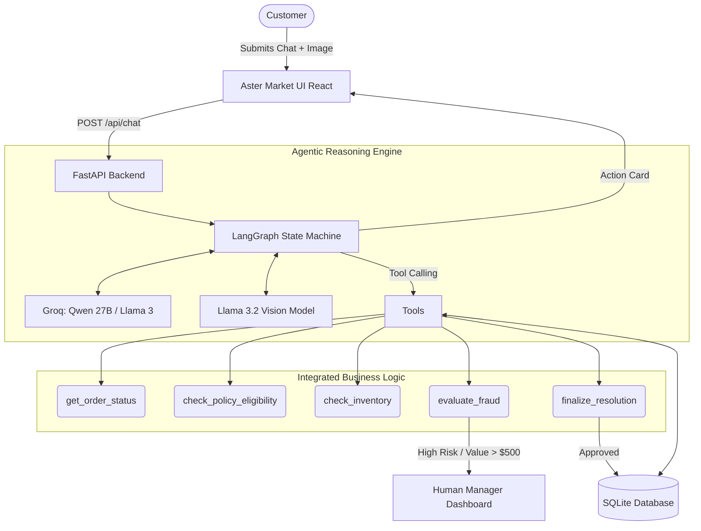

<div align="center">
  
  <h1>KITE: Knowledge-guided Issue Triage & Execution</h1>
  <p><b>An Autonomous Agentic Post-Purchase Resolution Platform for E-commerce</b></p>

  [](#-1-click-cloud-deployment)
  [](#)
  [](#)
  [](#)
</div>

---

**KITE** converts customer complaints into completed resolutions—not just support tickets. 

It is an autonomous after-sales agent that dynamically investigates customer complaints, analyzes visual evidence (images), verifies order and policy data, and executes refunds, replacements, or human escalations within seconds. 

To demonstrate KITE in a realistic environment, we built **Aster Market**, a simulated e-commerce frontend that showcases how KITE can integrate with any retailer to completely transform a customer's post-purchase experience.

---

## 🚀 The Problem & The Solution

**The Problem:** Post-purchase complaints require manual checks across orders, policies, images, inventory, and logistics. Slow and inconsistent resolutions increase support costs, refund leakage, and customer churn. Traditional chatbots and rigid return portals struggle heavily with evidence-based exceptions (e.g., damaged, defective, or missing items).

**The Solution:** KITE sees the issue, checks the facts, and completes the resolution using a state-of-the-art ReAct (Reasoning and Acting) AI architecture:
1. **Multimodal Investigation:** Parses the claim text and photos, then verifies the customer, order, and product context.
2. **Deterministic Guardrails:** Makes a policy-safe decision by checking the return window, warranty, inventory, item value, claim history, and risk rules using external tools.
3. **Automated Actions & Human Escalation:** Completes the action (initiates refund/replacement) automatically, or escalates uncertain/high-value cases to a Human Manager Dashboard.

---

## 🧠 System Architecture

KITE leverages an agentic orchestration layer built with **LangGraph**. Instead of a static flow, the AI reasons about the user's intent, dynamically fetches data from the database using Python tool bindings, evaluates fraud risks using a secondary LLM, and determines the final resolution state.



---

## 🛠 Tech Stack

### Frontend (Aster Market)
*   **Framework:** React 18, Vite, TypeScript
*   **Styling:** Custom CSS, Lucide React (Icons)
*   **Features:** Multi-turn chat UI, Base64 Image Upload, Real-time Human Manager Dashboard.

### Backend (KITE Brain)
*   **Framework:** FastAPI, Python 3.10+
*   **AI Orchestration:** LangChain, LangGraph
*   **LLM Providers:** Groq API (`qwen/qwen3.6-27b`, `llama-3.2-11b-vision-preview`)
*   **Database:** SQLite3 (Simulated E-commerce DB)

---

## ⚙️ Core Agentic Workflows

KITE operates through a rigorous 5-Phase pipeline bound to the LLM's reasoning engine:

1. **Information Gathering:** The agent parses the chat to extract the `order_id` and issue description. It will naturally ask follow-up questions if context is missing.
2. **Context Enrichment:** The agent uses the `get_order_status` tool to query the DB. *(Rule: If the item is "In Transit", KITE deterministically halts the refund process).*
3. **Visual & Policy Verification:** KITE uses a Vision Model to confirm the user's image matches the complaint, while querying `check_policy_eligibility` and `check_inventory`.
4. **Risk & Fraud Evaluation:** KITE runs the `evaluate_fraud_and_consistency` node. It flags items over $500, users with >2 recent claims, or visual discrepancies.
5. **Execution:** If safe, KITE issues an automated resolution. If flagged, it routes an Action Card to the **Human Manager Dashboard** for manual override.

---

## 💻 Local Setup Instructions

### 1. Backend Setup
Navigate to the backend folder and create a virtual environment:
```bash
cd backend
python -m venv venv
source venv/bin/activate  # On Windows: venv\Scripts\activate
pip install -r requirements.txt
```

Create a `.env` file in the `backend/` directory:
```env
GROQ_API_KEY=your_groq_api_key_here
```

Start the FastAPI server:
```bash
uvicorn main:app --reload --host 0.0.0.0 --port 8000
```

### 2. Frontend Setup
Open a new terminal and navigate to the frontend folder:
```bash
cd frontend
npm install
```

Start the Vite development server:
```bash
npm run dev
```
Navigate to `http://localhost:5173` to interact with Aster Market!

---

## ☁️ 1-Click Cloud Deployment

This project is fully containerized and configured for **Render Blueprints (Infrastructure as Code)**. 

To deploy both the FastAPI backend and the React frontend globally for free, simply click the button below and provide your API keys when prompted:

[](https://render.com/deploy?repo=https://github.com/DEBDEEP-BANERJ2E/KITE)

*(Render will automatically map the `VITE_API_URL` environment variable to ensure the cloud frontend correctly speaks to the cloud backend).*

---

## 🧪 Testing the Agent (Demo Scenarios)

To fully experience KITE's capabilities, try these specific prompts in the chat UI:

### Scenario A: The "In-Transit" Rejection
**Goal:** Ensure KITE respects real-time logistics logic.
*   **You:** *"I want to return my order ORD-1052"*
*   **KITE:** Uses tools to query the DB, discovers it hasn't been delivered yet, and politely refuses the return request until delivery is confirmed.

### Scenario B: High-Value Fraud Escalation
**Goal:** Test the Human-in-the-Loop Risk Gate.
*   **You:** *"I changed my mind, I want to return my Velvet Sofa (Order ORD-8888)."*
*   **KITE:** Queries the DB, notes the item costs $850 (>$500 threshold), and routes it to `pending_human_review`. 
*   **Manager Action:** Open the `/manager` tab in the Aster Market UI to manually click "Approve" or "Reject".

---

## 🌍 Sustainable Development Goals (SDGs)

KITE aligns with and directly supports the UN SDGs:
*   **Goal 9: Industry, Innovation and Infrastructure:** Upgrades technological capabilities for e-commerce by introducing resilient, agentic customer service infrastructure.
*   **Goal 12: Responsible Consumption and Production:** Accurately triaging product issues prevents usable items from being prematurely discarded and optimizes the reverse supply chain.
*   **Goal 8: Decent Work and Economic Growth:** Frees human support agents from repetitive, emotionally taxing complaints, allowing them to focus on complex, high-value problem solving.

---
*Developed as part of the IBM SkillBuild Internship: AI Automation.*
